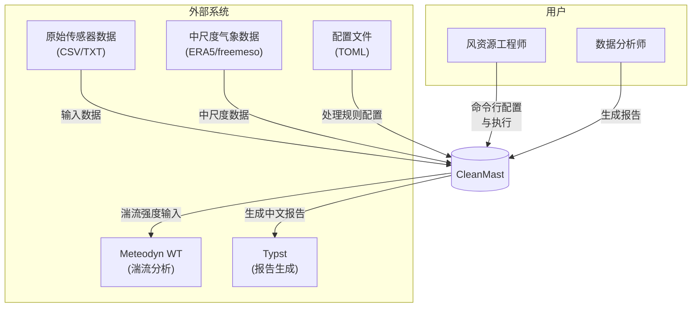

# CleanMast 系统上下文

## 系统上下文图

## 系统边界

CleanMast 位于系统中心，作为独立的数据处理工具运行。其边界定义如下：

**系统包含：**
- 数据解析模块（ParseSensors）
- 数据清理模块（DataClean）
- 数据重构模块（ReconstructSingleMast, ReconstructMeso, ReconstructCross）
- 分析模块（ReportTimeSeries, AnalyzeEN）
- 报告生成模块（ReportClean, ReportRecovery, ReportFrozenPeriod 等）

**系统不包含：**
- 原始数据采集设备
- 中尺度数据源（仅消费外部数据）
- 外部风资源评估软件
- 报告文档编辑系统

## 外部系统说明

### 原始传感器数据 (RawSensor)

CleanMast 处理来自气象测风塔的原始传感器数据。输入文件格式为 CSV 或 TXT，通常采用 NRG 格式。数据包含多高度的传感器测量值，包括风速、风向、温度、气压等。数据时间间隔通常为 10 分钟平均值（statType: avg）。

**数据来源：** 现场气象测风塔

### 中尺度气象数据 (MesoData)

外部中尺度再分析数据，用于数据重构和长序列校准。支持的格式包括 ERA5 和 freemeso-meso 格式。数据时间间隔为 1 小时。CleanMast 仅消费这些数据，不负责生成或管理中尺度数据源。

**数据来源：** ECMWF ERA5、freemeso 等外部服务商

### 配置文件 (ConfigFiles)

TOML 格式的配置文件，定义数据处理规则和参数。主要配置类型包括：

- `parse-sensors.toml` - 传感器列映射配置
- `process-clean.toml` - 数据清理规则配置
- `reconstruct-single.toml` - 单塔重构配置
- `train-meso.toml` - 中尺度模型训练配置
- `reconstruct-meso.toml` - 中尺度重构配置
- `representative-year.toml` - 代表年校准配置
- `report-*.toml` - 各类报告配置

配置文件可由 `recommend` 命令自动生成模板。

### Meteodyn WT

外部风资源评估软件，用于湍流强度分析。CleanMast 生成的时间序列数据可作为 Meteodyn WT 的输入。`report timeseries` 命令生成的报告包含来自 `meteodyn_ti.txt` 的湍流强度数据。

**关系：** CleanMast 输出数据作为 Meteodyn WT 的输入

### Typst

文档排版系统，用于生成中文技术报告。CleanMast 的所有报告模块（clean、recovery、frozen-period、cross-mast、reconstruct-single、reconstruct-meso、representative-year、meso-timeseries、timeseries）均通过 Typst 生成格式化的报告文件。

**关系：** CleanMast 调用 Typst 生成报告输出

## 用户说明

### 风资源工程师

主要用户群体，通过命令行接口执行数据处理任务。工作流程包括：项目配置生成（`recommend` 命令）、数据处理流水线执行（`process` 命令）、结果分析（`report` 命令）。

### 数据分析师

报告消费者，接收 CleanMast 生成的分析报告。报告涵盖数据清理效果、数据恢复率、相关性分析、代表年校准等主题。报告语言为中文（Typst 生成）。

## 数据流概要

**输入流：**
- 原始传感器 CSV/TXT 文件
- 中尺度气象数据 CSV 文件
- TOML 配置文件

**输出流：**
- 处理后的时间序列数据（CSV）
- 训练好的重构模型（JLD2）
- 分析报告（Typst 格式）
- 数据质量统计（process-stats/ 目录）

## 相关文档

- [文档导航中心](../../README.md) - 所有文档的入口
- [容器架构](../02-container/) - 详细模块说明
- [组件文档](../03-component/) - 组件接口详情
- [用户指南](../../user/) - 使用指南
- [开发文档](../../development/) - 开发者指南
