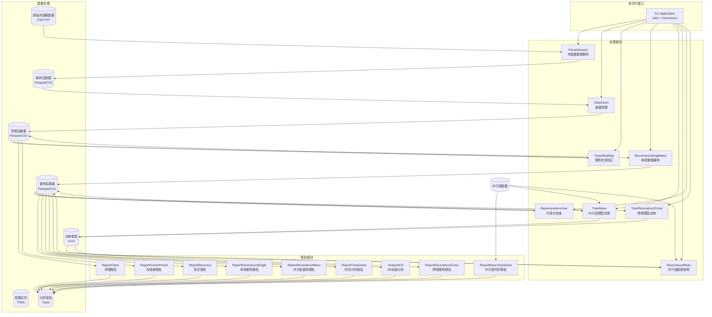

# CleanMast 容器架构

## 容器图

## 容器说明

### CLI Application

**技术栈：** Julia + Comonicon

**职责：** 提供命令行入口，接收用户命令和配置文件路径，协调各处理模块的执行。

**输入：** 用户命令行参数、TOML 配置文件路径

**输出：** 执行状态、各模块处理结果

### ParseSensors

**技术栈：** Julia + DataFrames.jl

**职责：** 解析原始传感器数据文件（CSV/TXT），将非结构化数据转换为结构化时间序列。识别传感器列、映射配置字段、生成标准化的解析后数据。

**输入：** 原始传感器 CSV/TXT 文件、parse-sensors.toml 配置

**输出：** ParsedData（Parquet/CSV 格式）、传感器描述文件

### DataClean

**技术栈：** Julia + DataFrames.jl

**职责：** 应用数据清理规则，检测并标记异常数据点。包括范围验证、层差检查、结冰检测等。清理后的数据保留原始时间序列结构，仅标记或移除不合格数据。

**输入：** ParsedData、process-clean.toml 配置

**输出：** CleanedData、清理统计信息

### TowerShading

**技术栈：** Julia + DataFrames.jl

**职责：** 检测塔影效应并进行校正。根据传感器安装位置和风向，识别塔架遮挡导致的风速异常，生成校正后的时间序列。

**输入：** CleanedData、tower-shading.toml 配置

**输出：** CleanedData（校正后）、塔影分析统计

### ReconstructSingleMast

**技术栈：** Julia + DataFrames.jl + GLM.jl

**职责：** 基于单测风塔相关性进行数据重构。当某高度传感器缺失时，利用其他高度传感器的相关性进行插补重建。

**输入：** CleanedData、reconstruct-single.toml 配置

**输出：** ReconstructedData、重构统计信息

### TrainMeso

**技术栈：** Julia + DataFrames.jl + GLM.jl + JLD2.jl

**职责：** 训练测风塔与中尺度数据之间的线性相关模型。建立风速、风向的对应关系，为后续中尺度重构提供模型参数。

**输入：** CleanedData/ReconstructedData、train-meso.toml 配置、中尺度数据

**输出：** Models（JLD2 格式）、训练结果统计

### ReconstructMeso

**技术栈：** Julia + DataFrames.jl + JLD2.jl

**职责：** 使用训练好的中尺度模型进行数据重构。将中尺度数据作为参考源，重构测风塔的长序列数据。

**输入：** Models、reconstruct-meso.toml 配置、中尺度数据

**输出：** ReconstructedData、重构质量评估

### RepresentativeYear

**技术栈：** Julia + DataFrames.jl + GLM.jl

**职责：** 执行代表年校准。将重构后的数据校准到长期气候代表值，确保时间序列具有气候学代表性。

**输入：** ReconstructedData、representative-year.toml 配置、中尺度气候数据

**输出：** ReconstructedData（校准后）、校准系数

### TrainReconstructCross

**技术栈：** Julia + DataFrames.jl + GLM.jl + JLD2.jl

**职责：** 训练跨测风塔重构模型。分析多塔之间的风速、风向相关性，建立跨塔数据填补模型。

**输入：** 多个测风塔的 ReconstructedData、train-reconstruct-cross.toml 配置

**输出：** Models（JLD2 格式）、相关性分析结果

## 报告模块

### ReportClean

**技术栈：** Julia + DataFrames.jl + TypstUtils.jl

**职责：** 生成数据清理报告，展示清理规则应用效果、违规统计、传感器清单等信息。

**输入：** CleanedData、process-stats/ 目录

**输出：** Reports（Typst 格式）

### ReportRecovery

**技术栈：** Julia + DataFrames.jl + TypstUtils.jl

**职责：** 生成数据恢复报告，展示各重构阶段的数据恢复率、恢复效果统计。

**输入：** 各阶段 ReconstructedData

**输出：** Reports（Typst 格式）

### ReportFrozenPeriod

**技术栈：** Julia + DataFrames.jl + TypstUtils.jl

**职责：** 生成传感器冻结期报告，分析低温环境下传感器可能出现的冻结异常。

**输入：** CleanedData、frozen-period 配置

**输出：** Reports（Typst 格式）

### ReportReconstructSingle

**技术栈：** Julia + DataFrames.jl + TypstUtils.jl

**职责：** 生成单塔重构效果报告，对比重构前后的数据质量变化。

**输入：** CleanedData、ReconstructedData

**输出：** Reports（Typst 格式）

### ReportReconstructMeso

**技术栈：** Julia + DataFrames.jl + TypstUtils.jl

**职责：** 生成中尺度重构质量报告，展示重构模型的效果指标（RMSE、相关系数等）。

**输入：** Models、ReconstructedData

**输出：** Reports（Typst 格式）

### ReportReconstructCross

**技术栈：** Julia + DataFrames.jl + TypstUtils.jl

**职责：** 生成跨塔重构分析报告，展示塔间相关性分析结果。

**输入：** Models、ReconstructedData

**输出：** Reports（Typst 格式）

### ReportTimeSeries

**技术栈：** Julia + DataFrames.jl + AlgebraOfGraphics.jl + TypstUtils.jl

**职责：** 生成综合时序分析报告，包括风速时间序列、风玫瑰、威布尔分布、湍流强度等分析结果。

**输入：** ReconstructedData

**输出：** Reports（Typst 格式）、图表文件

### ReportMesoTimeSeries

**技术栈：** Julia + DataFrames.jl + AlgebraOfGraphics.jl + TypstUtils.jl

**职责：** 生成中尺度数据年气候学分析报告，展示年际变化、多年均值等统计信息。

**输入：** 中尺度数据

**输出：** Reports（Typst 格式）

### AnalyzeEN

**技术栈：** Julia + DataFrames.jl

**职责：** 执行 EN 标准（欧洲工程标准）风速分析，生成符合土木工程荷载计算要求的统计分析结果。

**输入：** ReconstructedData、analyze-en 配置

**输出：** WindSpeedMatrix.txt 文件、Reports

## 数据存储说明

### 原始传感器数据

**格式：** CSV/TXT（NRG 格式）

**内容：** 测风塔原始传感器测量数据，包含多高度的 风速、风向、温度、气压等字段。

### 解析后数据

**格式：** Parquet/CSV

**内容：** 经过 ParseSensors 模块解析的标准化时间序列数据，保留完整的时间戳和传感器数值。

### 清理后数据

**格式：** Parquet/CSV

**内容：** 经过 DataClean 和 TowerShading 处理的数据，包含清理标记和校正后的数值。

### 重构后数据

**格式：** Parquet/CSV

**内容：** 经过 ReconstructSingleMast、ReconstructMeso、RepresentativeYear 等模块处理的数据，包含完整的长序列重构结果。

### 训练模型

**格式：** JLD2（Julia Data）

**内容：** TrainMeso、TrainReconstructCross 等模块训练的统计模型参数，用于后续的数据重构。

### 配置文件

**格式：** TOML

**内容：** 各类处理步骤的配置参数，包括传感器映射、清理规则、重构设置、报告选项等。

### 分析报告

**格式：** Typst

**内容：** 各报告模块生成的格式化文档，包含表格、图表、分析结论等综合信息。

## 数据流向说明

1. **解析流程：** RawData → Parse → ParsedData

2. **清理流程：** ParsedData → Clean → CleanedData → TowerShading → CleanedData

3. **单塔重构流程：** CleanedData → ReconstructSingle → ReconstructedData

4. **中尺度重构流程：** CleanedData → TrainMeso → Models → ReconstructMeso → ReconstructedData

5. **代表年校准流程：** ReconstructedData → RepresentativeYear → ReconstructedData

6. **报告生成流程：** 各阶段数据 → 对应 Report 模块 → Reports

## 相关文档

- [文档导航中心](../../README.md) - 所有文档的入口
- [系统上下文](../01-context/) - 高层系统视图
- [组件文档](../03-component/) - 组件接口详情
- [用户指南](../../user/) - 使用指南
- [技术文档](../../technical/) - 算法实现细节
