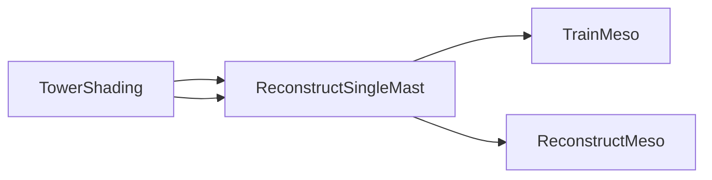

# ReconstructSingleMast

## 概述

单测风塔数据重构模块（ReconstructSingleMast）负责利用单测风塔内部传感器之间的相关性，重构缺失或异常的数据记录。该模块通过分析同一测风塔上不同高度、不同类型传感器（如风速计、风向标）之间的物理关联，建立相关性模型，从而估算缺失的测量值。

在数据处理流程中，单测风塔重构是连接数据清理与中尺度重构的关键环节。完成数据清洗和塔影校正后，该模块基于已验证的传感器数据建立内部相关性模型，对质量标记为可疑或缺失的时段进行智能填补，确保时间序列的完整性和连续性。

## 主要职责

- 加载经过清理的时间序列数据和传感器配置信息
- 分析同一测风塔内部各传感器之间的相关性模式
- 基于相关性模型重构缺失或异常的数据时段
- 保存重构后的时间序列数据及处理统计信息
- 输出重构结果摘要，包括成功重构和失败的时段统计

## 输入

- **时间序列数据文件**（CSV格式）：包含已清理的测风塔测量数据，每行对应一个时间点，列为各传感器测量值及其质量标记
- **传感器配置信息**（TOML格式）：描述各传感器的类型、高度、统计类型等元数据，用于识别有效重构目标
- **单测风塔重构配置文件**（reconstruct-single.toml）：指定输入输出路径、重构策略参数及目标传感器列表

## 输出

- **重构后的时间序列数据**：与输入格式相同的CSV文件，包含填补后的完整测量数据
- **更新后的传感器配置**：反映重构结果的传感器元数据
- **处理统计文件**（YAML格式）：记录重构过程的统计信息，包括每个mast的成功重构次数、失败次数及失败原因分类

## 依赖关系

- **上游依赖**：DataClean（数据清理）、TowerShading（塔影校正）—— 两者提供的清洁数据是重构的基础
- **下游依赖**：TrainMeso（中尺度训练）、ReconstructMeso（中尺度重构）—— 重构后的完整时间序列将用于中尺度数据融合
